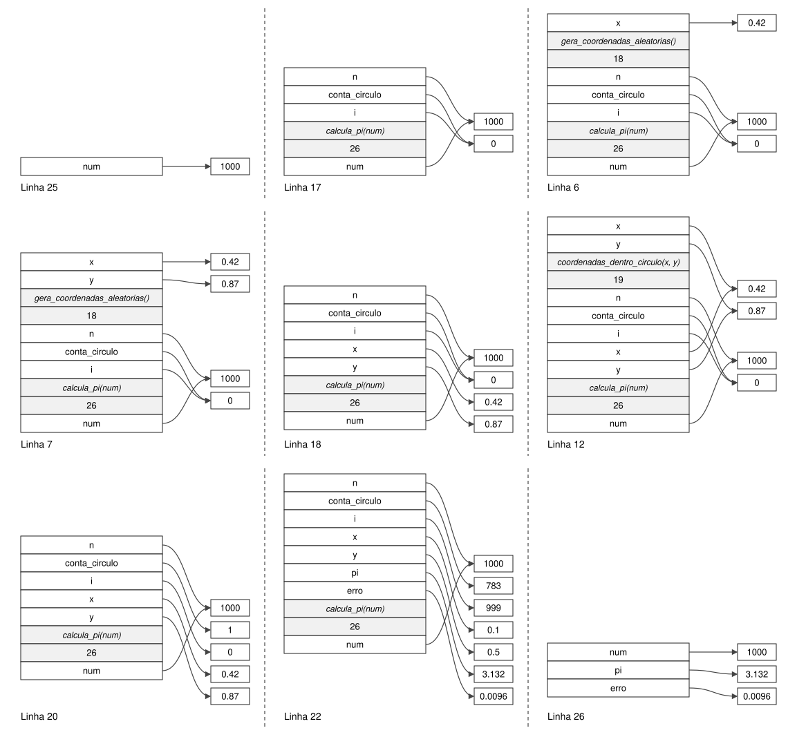

# 📘 Exercícios — Capítulo 4
# Subalgoritmos

[← Voltar](../)

---
## 4.2 Módulos em Python
### Exercício 4.1 - Tabela com tangente
Expanda a tabela de senos e cossenos para incluir também a tangente, usando a
função math.tan(). Cuidado! Você tem de se preocupar com as tangentes de
90 e 270 graus. Por quê? Trate estes casos especiais, evitando incorrer em erro. Use
math.inf e -math.inf para indicar valores infinitos, positivos e negativos.


### Exercício — Senos e cossenos




---
### Exercício 4.2 — Raízes quadradas
Escreva um programa que imprima uma tabela das raízes quadradas dos números
entre 10 e 100, com incrementos de 10.


### Exercício — Raízes quadradas




---
### Exercício 4.3 — Quadrado e cubo
Escreva um programa em Python que leia um número e imprima a si mesmo, o
seu quadrado e o seu cubo.


### Exercício — Quadrado e cubo


Este exercício foi pensado para usar o módulo math, porém uma solução mais imediata e mais eficiente poderia ser:






---
### Exercício 4.4 - Funções de math
Pesquise no manual on-line de Python outras funções matemáticas do módulo
math, disponível em: https://docs.python.org/3/library/index.html.

---
## 4.3 Funções
### Exercício 4.5 — Figura com asteriscos
Escreva um programa capaz de criar outras formas, usando uma função 
semelhante à que imprimiu a árvore.


### Exercício — Figura com asteriscos




---

### Exercício 4.6 — Árvore de natal (for)
Modifique o programa da árvore de natal para usar comandos for in
range() em vez de escrever explicitamente cada linha. Você vai precisar de 4
laços com for para desenhar a mesma árvore.


### Exercício — Árvore de natal (for)




---
### Exercício 4.7 — Conceito
Escreva uma função que dada uma nota entre 0.0 e 10.0 imprima na tela um
conceito entre ‘A’ e ‘E’, segundo a tabela:

A ≥ 9.0; 9.0 > B ≥ 8.0; 8.0 > C ≥ 7.0; 7.0 > D ≥ 5.0; E < 5.0.

O que acontece com o seu programa se for digitada nota menor que zero ou maior
que dez?


### Exercício — Conceito




---
### Exercício 4.8 — Quadrado de um número
Escreva uma função que receba um valor inteiro e devolva seu quadrado.


### Exercício — Quadrado




---
### Exercício 4.9 - Temperatura em Fahrenheit
Escreva uma função **fahrenheit(celsius)** que receba um valor de uma
temperatura Celsius e devolva seu equivalente em Fahrenheit. Usando esta
função, imprima os valores equivalentes das temperaturas Celsius em Fahrenheit
entre 0 e 100, com incrementos de 10. Use a fórmula: 
F = C * (9/5) + 32


### Exercício — Temperatura em Fahrenheit




---
### Exercício 4.10 - Celsius
Escreva uma função celsius(fahrenheit) que receba um valor de uma
temperatura Fahrenheit e devolva seu equivalente em Celsius. Usando esta
função, imprima os valores equivalentes das temperaturas Fahrenheit em Celsius
entre 0 e 300, com incrementos de 10. Coloque comandos para que o usuário
escolha os valores de início, fim e passo que serão usados como argumentos da
função.


### Exercício — Celsius




---
### Exercício 4.11 — Distância
Escreva uma função distancia(x1, y1, x2, y2) que devolva a
distância entre dois pontos cujas coordenadas cartesianas são (x1, y1) e
(x2, y2).


### Exercício — Distância




---
## 4.4 Funções que Retornam mais de um Resultado
### Exercício 4.12 — Pi com mais pontos
Modifique o programa que calcula pi para perguntar diversas vezes pelo número
de pontos a serem sorteados, calculando pi para cada pedido. O programa deve
terminar quando for digitado ‘0’.


### Exercício — Pi com mais pontos




---
### Exercício 4.13 — Dado de 6 lados
Use o módulo random para simular o lançamento de um dado de 6 lados. Use a
função randint().


### Exercício — Dado de 6 lados




---
## 4.5 Passagem de Parâmetros
### Exercício 4.14 — Evolução da pilha do Programa 4.16
Faça um desenho com a evolução da pilha, nos moldes da versão simplificada da
Figura 4.9, para a execução do Programa 4.16.

O Programa 4.16, com as linhas numeradas e os `import` do início:




### Exercício 4.14 — Evolução da pilha do Programa 4.16

**Como ler o desenho** (as mesmas convenções da Figura 4.9):

* Cada quadro mostra a pilha **depois de executar a linha indicada**.
* O topo da pilha fica no alto. Para cada função em execução, a pilha guarda as suas variáveis locais e parâmetros, a **função chamada** (em cinza e itálico, como `foo(n)` na figura do livro) e a **linha de retorno** (em cinza, o "9" da figura do livro), seguidas das variáveis de quem chamou.
* Uma seta liga o **nome** ao **objeto** na memória. Dois nomes com setas para o mesmo objeto referem-se ao mesmo valor.
* Como na versão simplificada, só aparecem as funções do programa. Ficam de fora os módulos `r` e `m`, as funções predefinidas (`int`, `input`, `print`, `range`) e os nomes das próprias funções.
* Os valores (`num = 1000`, `x = 0,42`, `y = 0,87`) são ilustrativos. Em cada execução os números sorteados são outros.

[](ex4.14_pilha_programa4.16.svg)

*Clique na figura para abrir em tamanho real.*

**Passo a passo:**

* **Linha 25.** Depois de `num = int(input(...))`, só existe a variável global `num`, ligada ao objeto 1000.
* **Linha 17.** `calcula_pi(num)` foi chamada na linha 26. O fluxo precisa saber para onde voltar, então a pilha guarda a **linha de retorno (26)** e a função chamada, `calcula_pi(num)`. Acima delas ficam o parâmetro `n`, que aponta para o **mesmo** objeto 1000 de `num`, e as locais `conta_circulo` (0) e `i` (0, a primeira volta do `for`).
* **Linha 6.** Na primeira volta do laço, a linha 18 chama `gera_coordenadas_aleatorias()`. A pilha ganha um novo conjunto de informações **por cima**: linha de retorno 18, a função chamada e a variável local `x` (0,42). As variáveis de `calcula_pi` continuam abaixo, intactas.
* **Linha 7.** A variável local `y` (0,87) é criada.
* **Linha 18.** A função retornou `(x, y)`. A parte de cima da pilha, usada por `gera_coordenadas_aleatorias()`, é **liberada**, e `calcula_pi` ganha as suas próprias `x` e `y`, ligadas aos objetos devolvidos (0,42 e 0,87).
* **Linha 12.** A linha 19 chama `coordenadas_dentro_circulo(x, y)`. A pilha ganha um novo conjunto com a linha de retorno 19, a função chamada e os parâmetros `x` e `y`, que apontam para os **mesmos objetos** 0,42 e 0,87 das variáveis de `calcula_pi`. Nada é copiado: é o mesmo caso do `n` e do parâmetro `n` da figura do livro.
* **Linha 20.** A função retornou `True`, pois `hypot(0,42; 0,87)` é cerca de 0,97, menor que 1. O conjunto de cima foi liberado, e `conta_circulo += 1` liga o nome a um **novo** objeto, 1. Números inteiros são imutáveis, então o 0 não foi modificado: o nome `i` ainda aponta para ele.
* **Linha 22.** Depois de 1000 voltas, o laço terminou. As variáveis locais `pi` (3,132) e `erro` (0,0096) foram criadas.
* **Linha 26.** `calcula_pi` retornou `(pi, erro)`. Todo o conjunto de informações dessa função foi liberado, e restam apenas as variáveis globais, com `pi` e `erro` ligadas aos objetos devolvidos. A linha 27 imprime o resultado.

**Observação.** Foi desenhada só a primeira volta do laço e a última etapa. Nas voltas seguintes a pilha repete o mesmo padrão: cada chamada empilha as suas informações e as libera ao retornar. Por isso, a pilha de `calcula_pi` nunca cresce com o número de pontos sorteados.



---
## 4.6 Global ou Local
### Exercício 4.15
Identifique as variáveis globais e locais do Programa 4.16.


### Exercício — Variáveis globais e locais
#### Variáveis globais

No nível do módulo (fora de funções):
- r → módulo random
- m → módulo math
- num → valor lido do input
- pi → resultado retornado por calcula_pi
- erro → resultado retornado por calcula_pi

👉 Observação importante:
**pi** aqui não é o mesmo **pi** dentro da função, são variáveis distintas em escopos diferentes.

#### Variáveis locais
1. Em __gera_coordenadas_aleatorias()__
   - x
   - y
2. Em __coordenadas_dentro_circulo(x, y)__
    - x (parâmetro)
    - y (parâmetro)
1. Em __calcula_pi(n)__
    - n (parâmetro)
    - conta_circulo
    - i (variável do for)
    - x
    - y
    - pi
    - erro

#### Obs: 
1. Parâmetros também são variáveis locais: parâmetros são criados no frame da função, como variáveis locais.
2. Mesmos nomes ≠ mesma variável: 
    Temos:
    ```python
    pi = 4*conta_circulo/n   # dentro da função
    ```
    e depois
    ```Python
    pi, erro = calcula_pi(num)
    ```
    👉 Isso é sombreamento de nomes, não compartilhamento.

3. __r__ e __m__ não são “variáveis comuns”:  Tecnicamente são nomes globais ligados a objetos módulo e não fazem parte da pilha de execução

Resumindo:

| Nome          | Escopo            | Tipo    |
| ------------- | ----------------- | ------- |
| r             | global            | módulo  |
| m             | global            | módulo  |
| num           | global            | inteiro |
| n             | local (parâmetro) | inteiro |
| x, y          | locais            | float   |
| conta_circulo | local             | inteiro |
| pi            | local/global      | float   |
| erro          | local/global      | float   |



---
## 4.7 Tente outra Vez
### Exercício 4.16
Escreva um programa que crie uma lista com 3 elementos e peça ao usuário um
índice de um elemento a ser impresso. Se o usuário pedir um índice fora da faixa
de valores permitidos (abaixo de zero ou acima de 2), o programa deve emitir
uma mensagem de erro (Use a exceção IndexError).


### Exercício — Tente outra vez




---
### Exercício 4.17
Modifique o programa anterior para que o mesmo capture também a exceção
ValueError da entrada de dados pelo usuário.


### Exercício — Tente outra vez (ValueError)




---

## Quer ir além?

Se você quiser se desafiar com novos problemas, sem solução disponível:

👉 [Exercícios extras do Capítulo 4](../../extras/cap4/)